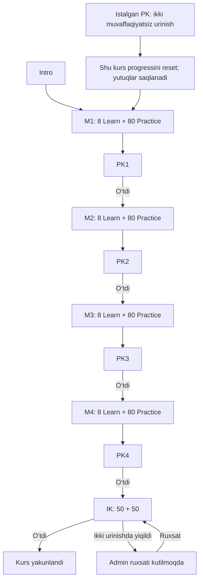

# PK va IK imtihonlari — asosiy amalga oshirish rejasi

**Asosiy manba:** `new docs/PK_IK_PLAN.md`. PK/IK uchun kod, JSX kontenti, migratsiya yoki test fayllarini yaratishdan oldin aynan shu hujjat o‘qiladi va undagi bosqichlar asosida ish bajariladi. Keyingi kelishuvlar va bajarilgan bosqichlar ham shu faylda yangilanadi; parallel reja nusxasi yaratilmaydi. 13-bo‘limdagi takliflar alohida tasdiqlanmaguncha foydalanuvchi tasdiqlagan talab deb olinmaydi.

> **Agent uchun:** bu hujjat PK/IKning kanonik talablari, rejasi va bajarish jurnalidir. Implementatsiya uchun foydalanuvchi ruxsat bergan; keyingi o‘zgarishlar va release natijalari ham shu hujjatda qayd qilinadi.

**Goal:** ingliz tili kursining har modulidan keyin PK, barcha modullardan keyin alohida IK ochish; savollarni JSX orqali yuklash, serverda baholash, urinishlar va progressni boshqarish.

**Architecture:** mavjud Learn/Practice oqimi saqlanadi; PK/IK uchun alohida imtihon modeli, statik JSX kontent shartnomasi va server baholagichi qo‘shiladi. Darslar va imtihonlarga kirish yagona server qoidalariga tayanadi. Qayta o‘qish progressi va doimiy yutuqlar alohida saqlanadi.

**Tech Stack:** mavjud Next.js App Router, React, TypeScript, Drizzle/PostgreSQL, Zod, Sucrase, sandbox iframe; testlar `node:test`/`tsx`, brauzer tekshiruvlari `playwright-core`.

**Spec:** foydalanuvchining 2026-11-09 talabi va ushbu hujjatdagi talablar. Shu suhbatda tasdiqlandi: **keyingi modul PKdan o‘tmaguncha yopiq**; **writing — qisqa yozma javob, avtomatik baholash**.

**Holat:** 2026-11-09 foydalanuvchi implementatsiyani, keyinchalik amaldagi bazaga migratsiya hamda barcha o‘zgarishlarni commit/push qilishni tasdiqladi. Ish `feat/pk-ik-exams` branchida. `0003` va `0004` amaldagi bazaga qo‘llandi; imtihonlar `disabled`. Kontentni platformaga yuklash, metodik tasdiq va enable alohida qoladi. Bajarish qaydlari §14da.

## 1. Tekshiruv chegarasi va amaldagi holat

Audit `C:\Users\User\Desktop\vertex\logistics-school` lokal papkasida bajarildi. DBga ulanilmadi, productiondagi nashr holati yoki o‘quvchi ma’lumotlari tekshirilmadi. README ichidagi oldingi yuklash qaydlari bugungi production holatining isboti sifatida olinmadi. JSX fayllar inventari, ma’lumot bloklari, reprezentativ topshiriqlar, backend va UI kodi o‘qildi; barcha 353 faylning brauzerda ishlashi bu auditda qayta sinalmadi.

| Lokal inventar | Tekshirilgan son |
|---|---:|
| Intro Learn | 1 |
| Asosiy modul | 4 |
| Har moduldagi Learn | 8 |
| Asosiy Learn jami | 32 |
| Har darsdan keyingi Practice | 10 |
| Har moduldagi Practice | 80 |
| Practice jami | 320 |
| Learn + Practice JSX jami | 353 |

### 1.1. Kurs kontenti

| Modul | 8 darsning mazmuni | PKda tekshiriladigan ko‘nikmalar |
|---|---|---|
| M1 — English Foundations | Gap/savol tuzish; Present Simple/Continuous; Past Simple; Present Perfect; kelajak; modallar; First Conditional; asosiy logistika lug‘ati | Gap tartibi, zamon, muloyim so‘rov, shart-natija, rollar, hujjat va transport atamalari |
| M2 — Everyday Communication | Tanishtirish; ma’lumot so‘rash; son/sana/vaqt; spelling/tasdiqlash; telefon muloqoti; formalar; oddiy email; yozma tasdiq | Muloyim va bilvosita savol, raqam/IDni aniq yozish, forma, emailning qismlari, read-back |
| M3 — Workplace Communication | Load ma’lumoti; rate confirmation; pickup/delivery; update so‘rash; kechikish; professional update; ko‘rsatmani aniqlashtirish; ish vaziyatlari | Hujjatdan dalil, shartlarni solishtirish, fakt/taxmin, ETA, qisqa update va aniqlashtirish |
| M4 — Professional Logistics English | Broker muloqoti; booking; rate negotiation; driver; koordinatsiya; kechikish/favqulodda holat; dispute; to‘liq case | Ko‘p shartli holat, vakolat/tasdiq, pending/confirmed, shartli majburiyat, dalilli qaror, handover |

M1 nazariya va mashqlardan iborat; M1L01 maxsus JSX/Rive komponentli, qolgan Learn fayllarining aksariyati `DATA` va umumiy renderer shaklida. M2 — 20 slayd va 5 nazariya; M3 — 21–22 slayd va 6–7 nazariya; M4 — 24–26 slayd va 8–10 nazariya. Har biridan so‘ng alohida p01–p10 fayllar keladi. Practice ichida MC, TYPE, MATCH, ORDER, READ-MC, READ-TYPE, FIX, FORM, SCENE va boshqa mexanikalar bor. P10 — yakuniy vaziyat.

**Muhim farq:** mustaqil PK/IK mavjud emas, lekin Learn ichida qisqa testlar bor. M1–M3 oddiy darslarida 4, L08 checkpointlarida 8 savol; M4 oddiy darslarida 6, M4L08 ichida 12 savol. `passThreshold()` oddiy Learn uchun 60%, L08 uchun 70% belgilaydi. Bular yangi PK/IKning 80% chegarasi va 2 urinish limitiga qo‘shilmaydi. M4L08 sarlavhasidagi “Final Assessment” nomini keyinchalik “Module 4 Review” mazmunida aniqlashtirish tavsiya qilinadi; uning o‘zi IK bo‘lib qolmaydi.

### 1.2. Koddagi tayanch nuqtalar

| Manba | Amaldagi vazifasi / yangi ishga ta’siri |
|---|---|
| `src/db/schema.ts` | `courses`, `modules`, `lessons`, `lesson_files`, `lesson_progress`, `practice_attempts`, eski `progress`, `audit_log`; imtihon jadvallari yo‘q |
| `src/lib/lessons/sequence.ts` | Intro va oldingi darsning Learn + Practice tugashiga qarab navbatdagi dars ochiladi; PK tekshiruvi yo‘q |
| `src/lib/lessons/access.ts` | Kurs dostupi, dars ketma-ketligi, keyingi dars havolasi; `nextAccessibleLesson()` hozir modul oxiridan keyingi darsni tanlaydi |
| `src/app/api/learn/lessons/[id]/progress/route.ts` | Learn payloadidan ball, Practice payloadidan `correct` qabul qiladi; p10 tugaganda ikki progress jadvali yangilanadi |
| `src/lib/lessons/rules.ts` | Fayl nomi faqat INTRO yoki M1–M4/L01–L08 Learn/Practice; yangi imtihon nomi hozir rad etiladi |
| `src/lib/lessons/compile.ts`, `frame.ts` | Kompilyatsiya, import/API cheklovlari, CSP, `allow-scripts` sandbox |
| `runtime/entry.tsx`, `src/components/learn/lesson-frame.tsx` | Faqat `learn` va `practice` bridge; nonce va iframe manbasi tekshiriladi |
| `src/components/admin/lesson-manager.tsx`, lesson file APIlari | Upload → draft/version/hash → preview tasdig‘i → publish; UI “Saqlash va nashr qilish” orqali preview belgisini avtomatik ham qo‘yadi |
| `src/app/admin/courses/[id]/page.tsx`, `module-manager.tsx` | PK/IK boshqaruvi qo‘shiladigan kurs/modul sahifasi |
| `src/components/learn/learn-navigation.tsx` | “Imtihonlar” bandi mavjud, lekin havolasiz/“Tez kunda” |
| `src/app/learn/(dashboard)/profile/page.tsx`, `profile-settings.tsx` | Yutuqlar eski `progress.completedAt` sonidan hisoblanadi: 1/5/10 dars. Alohida doimiy yutuq yozuvi yo‘q |
| `src/app/learn/(dashboard)/page.tsx` | Progress, haftalik/recent va yutuq previewi eski `progress`dan olinadi; resetda bu farq hisobga olinishi kerak |

O‘rnatilgan Next.js **16.4.3**; `package.json` diapazoni `^16.0.0`. Lokal `node_modules/next/dist/docs/01-app/01-getting-started/15-route-handlers.md` o‘qildi. Implementatsiya oldidan tegishli auth, server/client, route va cache qo‘llanmalari ham qayta tekshirilsin; dinamik `params` Promise shaklida qoladi.

## 2. Global talablar

- PK har bir asosiy modulga biriktiriladi; shu modulning 8 Learn va 80 Practice topshirig‘i to‘liq yakunlangach ochiladi. Oldingi PKlardan ham o‘tilgan bo‘lishi kerak.
- PK: 30 ta asosiy savol + 20 ta o‘quvchi yozadigan vocabulary = **50 ta baholanadigan birlik**.
- Keyingi modul oldingi PKdan muvaffaqiyatli o‘tilgach ochiladi.
- PK 2 urinishda ham topshirilmasa shu kursning progressi boshiga qaytadi; yutuqlar saqlanadi.
- IK: 32 dars, ularning 320 Practice topshirig‘i va barcha 4 PK tugagach alohida Final Exam ochiladi.
- IK 1-bo‘lim: **20 reading + 15 writing + 15 grammar = 50**. Reading: 2 matn, har birida 10 savol; matching, completion, multiple choice formatlari.
- IK 2-bo‘lim: kursning butun matnli kontentidan **50 ta yozma vocabulary**. Variant va matching bo‘lmaydi.
- PK va IKning o‘tish chegarasi alohida sozlanadi, default **80%**. Admin UI va DB/API defaultlari bir xil bo‘lsin.
- IK 2 urinishda ham topshirilmasa progress saqlanadi; keyingi urinish faqat admin ruxsati bilan.
- Har bir savol modulga bog‘lanadi. IKdan yiqilganda eng ko‘p xato qilingan modul(lar) ko‘rsatiladi; o‘tganda bu tahlil shart emas.
- Savollarni yaratish/yuklash/nashr qilish — `super_admin`; IKga qayta ruxsat — `admin` va `super_admin`.
- Ovoz, tashqi API, mikrofon, AI baholash va IELTS band score bu ishga kirmaydi. Interfeys mavjud `uz/ru/en` tizimiga ulanadi, inglizcha test kontenti tarjima qilib javobni oshkor qilmaydi.

## 3. Arxitektura qarori

Ko‘rib chiqilgan yo‘llar:

1. **PK/IKni oddiy darsga o‘xshatib saqlash.** Upload oson, lekin 10 Practice cheklovi, client balliga ishonish va maxsus reset/urinishlar qoidalari bilan mos kelmaydi.
2. **Alohida exam modeli + mavjud sandbox/upload UXidan foydalanish — tavsiya.** O‘quv kontenti o‘z joyida qoladi, baholash va kirish serverda mustaqil bo‘ladi. Bitta `.jsx` yuklash tajribasi saqlanadi.
3. **Tashqi test servisi.** Ikkinchi login, progress sinxronlash va JSX talabidan chekinish keltiradi; bu reja uchun olinmaydi.

Ikkinchi yo‘l ushbu rejaning taklif etilgan texnik qarori. IK DBda beshinchi o‘quv moduliga aylantirilmaydi: kursga biriktirilgan `kind=ik` exam bo‘ladi, UI oxirgi “Final Exam” bosqichi sifatida ko‘rsatadi. Shunda 4 modul bo‘yicha statistika va darslar soni buzilmaydi.

## 4. O‘quvchi oqimi va urinishlar



### 4.1. Umumiy qoidalar

- Boshlash sahifasida tarkib, o‘tish foizi, qolgan urinish va muvaffaqiyatsizlik oqibati aniq yoziladi. Sahifani ochish urinish sarflamaydi.
- “Boshlash” server tranzaksiyasida urinish ochadi va bitta slotni band qiladi. Bir faol urinish bo‘lsa, yangisini ochmaydi, o‘shani qaytaradi.
- Refresh, internet uzilishi yoki chiqib kirish ayni urinishni davom ettiradi; yangi urinish sanalmaydi. Javoblar serverga autosave qilinadi, UI saqlash holatini ko‘rsatadi.
- Boshlanganda exam versiyasi, threshold, savollar/modul tartibi va option tartibi urinishga mahkamlanadi. Admin keyin o‘zgartirgan qiymat davom etayotgan urinishga ta’sir qilmaydi.
- Javobni yakuniy yuborishgacha o‘zgartirish mumkin. Har savoldan keyin to‘g‘ri javob, hint yoki correctness qaytarilmaydi.
- Bo‘sh javob 0 ball. “Yakunlash” oldidan javobsiz savollar soni ko‘rsatiladi; o‘quvchi baribir yakunlay oladi.
- Yakuniy yuborish idempotent: bir urinish bir marta baholanadi. Takror yuborish avval saqlangan natijani qaytaradi.
- Vaqt limiti foydalanuvchi tomonidan belgilanmagan: **birinchi versiya uchun taklif — taymersiz**, davomiylik faqat qayd qilinadi. Brauzerni yopish avtomatik yiqilish emas.
- Texnik nosoz urinishni admin sabab bilan `void` qilishi mumkin; o‘quvchining oddiy xatolari texnik bekor qilishga kirmaydi. `void` urinish limitni yemaydi va auditdan o‘chirilmaydi.
- Birinchi versiyada har PK uchun bitta to‘liq 50 savollik to‘plam, IK uchun bitta 100 savollik to‘plam: jami **300 savol**. 2 urinish — majburiy, ikki xil A/B to‘plam esa alohida talab emas. Ikkinchi urinishda savol/variant tartibi qayta aralashtiriladi, reading guruhlari saqlanadi; yangi savollar kafolatlanmaydi. A/B bank keyingi alohida yaxshilash bo‘lishi mumkin.

### 4.2. PKning ikkinchi muvaffaqiyatsiz urinishidan keyin

Bitta tranzaksiya ichida:

1. Ikkinchi urinishning natijasi va snapshoti saqlanadi.
2. Shu o‘quvchi + shu kurs uchun o‘qish sikli `cycle + 1` qilinadi.
3. Faqat shu kursning asosiy darslari uchun `lesson_progress`, `practice_attempts` va eski `progress` joriy yozuvlari tozalanadi. Shu sabab p01–p10 ham qayta bajariladi.
4. Oldingi sikldagi barcha PK natijalari tarixda qoladi, lekin yangi siklda ochilish huquqi bermaydi. Yangi siklda har PK uchun yana 2 urinish mavjud.
5. IK natijalari/tarixi o‘chirilmaydi; yangi siklda eski sikldagi prerequisite yoki grant ishlamaydi.
6. Yutuq yozuvlari, profil, kurs dostupi/to‘lov muddati, boshqa kurslar va account o‘zgarmaydi.
7. `course.progress_reset` auditiga sabab, exam/attempt ID, eski/yangi sikl va tozalangan yozuvlar soni yoziladi.

**Taklif:** Intro umumiy demo bo‘lgani uchun qayta majburiy qilinmaydi; kurs boshidagi birinchi asosiy dars — **M1L01**. Natija avval ko‘rsatiladi: “Ikki urinishda o‘tish chegarasiga yetilmadi. Kurs progressi yangilandi. Yutuqlaringiz saqlangan.” So‘ng M1L01ga tugma.

Reset bilan bir vaqtda kelgan eski Learn/Practice POSTlari progressni qayta tiklab yubormasligi shart. Lesson GET `cycle` qaytaradi; yangi progress POST uni yuboradi, server bir xil `course_learning_state` lock ostida sikl va accessni qayta tekshiradi. Eski sikl POSTi `409`, hatto M1L01 hanuz ochiq bo‘lsa ham. Intro bu kurs siklidan mustaqil.

### 4.3. IKdagi ikkinchi muvaffaqiyatsiz urinish

- `awaiting_admin` holati chiqariladi. Dars progressi, 4 PK natijasi va yutuqlar o‘zgarmaydi.
- Admin o‘quvchi kartasida natijalarni ko‘radi va sabab kiritib “IK uchun yana 1 urinish berish”ni bosadi.
- **Taklif:** har ruxsat aynan bitta qo‘shimcha urinish beradi. U ham muvaffaqiyatsiz bo‘lsa yana admin ruxsati kerak. Oldingi urinishlar o‘chirilmaydi, counter nol qilinmaydi.
- Ruxsat faqat urinish limitini kengaytiradi; kurs dostupi, barcha darslar va PK talablari baribir tekshiriladi. Adminning ikki marta bosishi bitta `requestId` bilan bitta grant yaratadi.
- IKdan o‘tgan o‘quvchi uchun qayta boshlash yopiladi; natijani ko‘rish ochiq qoladi.

Limit formulasi: joriy `studentId + examId + cycle` uchun ruxsat = PKda 2, IKda `2 + grantlar soni`; band qilingan/sarflangan slotlar = `in_progress`, `passed`, `failed` urinishlar soni. `void` hisoblanmaydi. `attemptNo` audit uchun monoton oshadi, limit tekshiruvi eng katta attemptNo orqali qilinmaydi. `passed` bo‘lsa qolgan slotga qaramay yangi attempt yopiq; mavjud `in_progress` bo‘lsa avval o‘sha davom ettiriladi.

## 5. Savol va baholash loyihasi

### 5.1. PK: 30 + 20

30 asosiy savol shu moduldagi barcha 8 darsni qamraydi: 6 darsdan 4 tadan va 2 darsdan 3 tadan. Qaysi darslar 3 savol olishi modulning maqsadlariga qarab blueprintda oldindan belgilanadi. 20 vocabulary shu moduldagi matn, qoida, savol, dialog, phrase bank va lug‘atdan olinadi; har darsga kamida bitta manba bog‘lanadi. Bir item faqat bitta asosiy modulga hisoblanadi.

Tavsiya etilgan Bloom taqsimoti: Remember 6, Understand 6, Apply 10, Analyze 6, Evaluate 2 = **30**. Vocabulary alohida: Remember 10 + kontekstni tushunish Understand 10 = **20**. Bloom sonlari metodik taklif, foydalanuvchi belgilagan qat’iy foizlar emas.

### 5.2. IK: 4 modulga muvozanatli taqsimot

50 soni 4ga qoldiqsiz bo‘linmaydi. Alohida 50 savolli bo‘limlarda farq ko‘pi bilan 1, umumiy 100 savolda esa **har modulga aynan 25** taklif qilinadi:

| Bo‘lim | M1 | M2 | M3 | M4 | Jami |
|---|---:|---:|---:|---:|---:|
| Reading | 5 | 5 | 5 | 5 | 20 |
| Writing | 4 | 4 | 4 | 3 | 15 |
| Grammar | 4 | 4 | 3 | 4 | 15 |
| Asosiy qism | **13** | **13** | **12** | **12** | **50** |
| Vocabulary | 12 | 12 | 13 | 13 | 50 |
| Barcha savollar | **25** | **25** | **25** | **25** | **100** |

Asosiy 50 savol uchun Bloom jadvali:

| Daraja | M1 | M2 | M3 | M4 | Jami |
|---|---:|---:|---:|---:|---:|
| Remember | 2 | 2 | 2 | 2 | 8 |
| Understand | 3 | 3 | 3 | 3 | 12 |
| Apply | 4 | 4 | 4 | 4 | 16 |
| Analyze | 3 | 3 | 2 | 2 | 10 |
| Evaluate | 1 | 1 | 1 | 1 | 4 |
| Jami | **13** | **13** | **12** | **12** | **50** |

Vocabulary Bloom taqsimoti: M1/M2 uchun Remember 6 + Understand 6; M3/M4 uchun Remember 6 + Understand 7. Barcha 100 item bo‘yicha ham darajalar yaqin muvozanatda bo‘ladi. Authoringda `section × module × bloom` kesimida tekshiriladi; faqat jadvalga mos yorliq qo‘yish yetmaydi, savol haqiqatan shu fikrlash amalini talab qilishi kerak.

Bloom — faqat “oson/o‘rta/qiyin” nomlari emas, kognitiv amallar tasnifi. Remember, Understand, Apply, Analyze, Evaluate, Create tushunchalari asos qilinadi. **Create birinchi avtomatik versiya blueprintida 0**: erkin original matn yaratishni aniq javoblar ro‘yxati bilan to‘liq baholab bo‘lmaydi. Qisqa gap yozishning o‘zi avtomatik ravishda Create deb belgilanmaydi. Barcha 6 daraja majburiy bo‘lishi istalsa bu writing baholash doirasini qayta kelishishni talab qiladi. Metodik asos: [UC Davis — Bloom’s Revised Taxonomy](https://assessment.ucdavis.edu/defining-expectations-student-learning), [Cornell — Bloom’s Taxonomy](https://teaching.cornell.edu/resource/blooms-taxonomy).

### 5.3. Reading — aynan 2 matn / 20 item

- Original, kurs doirasidagi inglizcha logistika matnlari yoziladi. IELTSdan tayyor matn/savol ko‘chirilmaydi.
- Matn A: M1/M2 bilimlarini talab qiladigan tanishish, yuk tafsiloti va yozma tasdiq holati; 5+5 item.
- Matn B: M3/M4 bilimlarini talab qiladigan hujjatlar, update va shartlari o‘zgargan case; 5+5 item.
- Har matnda 4 multiple choice, 3 matching va 3 completion = 10 mustaqil baholanadigan item. Jami 8 MC + 6 matching + 6 completion.
- Har matching jufti alohida item; “bir savolda 5 juft” bilan 20 soni yashirin oshirilmaydi. Completionda bitta baholanadigan javob maydoni bo‘ladi.
- Completion uchun aniq so‘z/raqam chegarasi yoziladi va tekshiriladi. Savolga javob matnda topiladi yoki undagi dalildan kelib chiqadi; tashqi logistika bilimiga muhtoj bo‘lmaydi.
- Matn uzunligi uchun dastlabki metodik taklif 250–350 so‘zdan; yakuniy uzunlik kurs darajasiga mos ekspert tekshiruvidan o‘tadi.
- Desktopda matn va savollar yonma-yon, mobilda qulay almashtirish/scroll. Savol tartibi matn blokidan uzilmaydi.

Matching, multiple choice va completion — [rasmiy IELTS Reading formatida](https://ielts.org/take-a-test/test-types/ielts-academic-test/ielts-academic-format-reading) mavjud turlar. Bu kursning 2 matnli/20 savolli moslashtirilgan imtihoni; rasmiy IELTS test hajmi yoki band tizimi ko‘chirilmaydi.

### 5.4. Writing — 15 qisqa yozma javob

Foydalanuvchi tasdiqlaganidek, hammasi o‘quvchi klaviaturada yozadigan va server tekshiradigan topshiriqlar. Tavsiya etilgan tarkib: 5 ta gapni berilgan shaklga aylantirish, 5 ta aniq xatoni tuzatib yozish, 5 ta ko‘rsatilgan qolip bo‘yicha qisqa ish xabari/javobi. M1 grammatik kommunikativ qolip, M2 email/tasdiq, M3 update/clarification, M4 shart va statusga mos yozma javobni tekshiradi.

Har itemda vazifa chegarasi, zarur faktlar, so‘z chegarasi, qabul qilinadigan muqobil javoblar va noto‘g‘ri yaqin misollar muallif tomonidan oldindan beriladi. Erkin essay yoki cheksiz paraphrase topshirig‘i qo‘yilmaydi. Agar asosli muqobil javoblar ro‘yxatini tuzib bo‘lmasa, item qayta yoziladi; javob “kalit so‘z bor ekan” degan mezon bilan o‘tkazilmaydi. AI baholash yo‘q.

### 5.5. Grammar — 15 savol

Taklif: 5 multiple choice, 5 yozib gap to‘ldirish, 5 yozib xato tuzatish. Har birining asosiy modul manbasi ko‘rsatiladi; masalan M2 uchun indirect questions, M3 uchun kursdagi update qoliplari, M4 uchun shartli majburiyat va status tili. M1 grammatikasini shunchaki M4 deb belgilab muvozanat yaratish mumkin emas. Kursda o‘rgatilmagan yangi grammatika qo‘shilmaydi.

### 5.6. Vocabulary korpusi va yozma tekshiruv

Manba faqat “Vocabulary” slaydlari emas: INTRO, 32 Learn va 320 Practice ichidagi o‘quvchiga ko‘rsatiladigan inglizcha matn, savol, variant, qoida misoli, dialog, explanation va phrase bank inventarlanadi. CSS/JS kalitlari va texnik metadata korpusga kirmaydi. INTROda uchragan so‘z IKga tanlansa, u 4 asosiy moduldan kamida birida ham qayd qilingan bo‘lishi kerak; Intro beshinchi statistik modul emas.

Korpus har so‘z/iboraga uchragan barcha manbalarni saqlaydi; 50 savol — shu korpusdan tanlov, kursdagi barcha so‘zlar tekshiriladi degani emas. Inflected form/lemma va sinonimlar avtomatik birlashtirib yuborilmaydi; kurator tekshiradi. Bir attemptda bir lemma/ibora takroran so‘ralmaydi. Qayta uchraydigan so‘zga bitta `primaryModuleId`, qolganlariga source reference beriladi.

**Taklif etilgan format:** o‘zbekcha ma’no yoki inglizcha kontekst/ta’rif → inglizcha so‘z/ibora yozish. Har savolda qaysi shakl/til talab etilishi aniq. Variant, matching, word-bank va javobni ko‘rsatuvchi autocomplete yo‘q. Writing/vocabulary maydonida `spellCheck=false`, autocorrect/autocomplete o‘chiriladi; tashqi vositalarni to‘liq to‘sish va’dasi berilmaydi.

Normalizatsiya: Unicode NFC, bosh/oxir bo‘shliq, takroriy bo‘shliq va apostrof variantlari; case qoidasini item belgilaydi. Muqobil spelling/ibora faqat `acceptedAnswers` orqali. Inkor, ID, raqam, birlik, vaqt zonasi va ma’noli hyphen olib tashlanmaydi. Fuzzy typo/substring bilan o‘tkazish yo‘q. `POD` va `proof of delivery` faqat shu item ikkisini ham ruxsat qilsa teng. Savolda kengaytma so‘ralgan bo‘lsa acronymning o‘zi o‘tmaydi.

### 5.7. Ball va xato modullar hisoboti

**Taklif:** har item 1 yoki 0 ball; manfiy va qisman ball yo‘q; umumiy foiz bo‘yicha o‘tish. Bo‘limlar uchun alohida minimum belgilanmaydi.

- PK: `correct / 50 × 100`; defaultda 40/50 o‘tadi, 39/50 o‘tmaydi.
- IK: `correct / 100 × 100`; defaultda 80/100 o‘tadi, 79/100 o‘tmaydi.
- `passPercent` butun son 1–100, default 80. O‘tish tekshiruvi `correct × 100 >= passPercent × total`; ekrandagi yaxlitlangan foiz qaror mezoni emas. Masalan PK 85% bo‘lsa kamida 43/50 kerak.
- Threshold exam darajasida: 4 PKning har biri alohida; IK kurs finali sifatida alohida. Forma yaratishda maydon 80 bilan to‘ldiriladi, JSX uni yashirin o‘zgartira olmaydi.
- IK o‘tilmasa barcha 100 savol, jumladan vocabulary va bo‘sh javoblar asosida har modul uchun `correct`, `wrong`, `total`, `wrongRate` hisoblanadi. Hozir har modul 25 item, shuning uchun xato sonini to‘g‘ridan-to‘g‘ri solishtirish adolatli.
- Eng katta `wrong`ga ega barcha modullar ko‘rsatiladi; tenglikda bitta modul tasodifan tanlanmaydi. Modul nomi, xato/25 va qayta ko‘rish havolasi chiqadi. Asosiy qism/vocabulary kesimi yordamchi ko‘rsatkich bo‘lishi mumkin.
- Chegara 80dan o‘zgartirilsa diagnostika `passed=false`ga bog‘lanadi. Masalan 90% talabda 85% olgan ham diagnostika ko‘radi. Bu foydalanuvchining sozlanadigan threshold talabiga mos taklif.
- O‘tgan o‘quvchiga natija va yakunlash xabari; “eng yomon modul” chiqarilmaydi. Javob kaliti keyingi urinish oldidan oshkor qilinmaydi; admin to‘liq tekshiruv tafsilotini ko‘radi.

## 6. JSX imtihon shartnomasi

Fayl nomlari: `M1.pk.jsx`, `M2.pk.jsx`, `M3.pk.jsx`, `M4.pk.jsx`, `COURSE.ik.jsx`. Kurs va modul UUIDlari upload oynasidagi tanlov bilan serverda bog‘lanadi; fayldagi identifikatorga ko‘r-ko‘rona ishonilmaydi. Learn/Practice filename qoidalari o‘z holida qoladi.

Bitta JSX fayl: **statik JSON-literal `examDefinition` + platformadagi `ExamScreen`ni chaqiradigan standart default komponent**. Shu orqali foydalanuvchi darslar kabi `.jsx` yuklaydi, lekin baholash kodi fayl tomonidan boshqarilmaydi. Maxsus erkin JS renderer birinchi versiya doirasiga kirmaydi; ko‘rinish uchun cheklangan theme qiymatlari ruxsat etiladi.

Majburiy metadata:

- Exam: `schemaVersion=1`, `kind`, `moduleCode` (PK), title, passages, questions.
- Item: unique `id`, `section`, `moduleCode`, `bloom`, `difficulty`, `type`, prompt, optional `passageId/options`, `sourceRefs`, private grading rule.
- `sourceRefs`: lesson code + learn/practice slot + source version/hash + slayd/task/theory reference; authoringda lokal path ham bo‘lishi mumkin, nashrda DBdagi current versiya bilan bog‘lanadi.
- Private grading: stable option ID yoki `acceptedAnswers`, normalization/word-limit qoidasi, javob sababi. Public DTOga bular va source metadata/modul yorliqlari kirmaydi.

Upload oqimi:

1. Faqat super admin, same-origin, hajm limiti (taklif: fayl 1.5 MB, request 2 MB), `.jsx`, filename/scope mosligi.
2. JSX AST orqali ruxsat etilgan deklarativ skelet tekshiriladi. Static JSON uchun function/call/spread/computed/getter ruxsat etilmaydi. Source serverda `eval`, `Function`, `vm` yoki import orqali bajarilmaydi.
3. `examDefinition` alohida parse qilinadi; Zod va blueprint validatori sonlar, section/module/Bloom, reading 2×10, vocabulary TYPE, duplicate IDs/lemmas, source refs, grading qoidalarini tekshiradi.
4. Original source va answer key faqat admin/server saqlovida qoladi. Student renderer ishonchli platforma templateidan generatsiya qilinadi; original JSX/compiled source studentga yuborilmaydi. Public data allowlist asosida tuziladi, keylarni blacklisting qilib o‘chirishga tayanilmaydi.
5. Hash/version bilan draft saqlanadi. Super admin sandbox preview, yozma javoblar va blueprint hisobotini tekshiradi; manba doirasi/Bloom mosligi inson tomonidan tasdiqlanadi.
6. Publish faqat validator + aynan shu hash uchun preview/content-review tasdiqlari bilan. Preview urinishlar student attempt yoki yutuq yaratmaydi.

AST uchun kichik, ochiq APIli `@babel/parser`ni bevosita dependency sifatida qo‘shish taklif qilinadi; source konvertatsiyasini bajarish shart emas, ishonchli renderer alohida hosil qilinadi. Hozirgi regex tekshiruvini maxfiy answer key ajratgichi sifatida ishlatmaslik kerak.

Bridge `kind="exam"`: public exam, saved answers, `onAnswerChange`, `onReady`, `onRequestSubmit`. Iframe raw javob yuboradi; parent autosave/final submit APIlarini chaqiradi. `scorePercent`, `correct`, `passed`, client yuborgan modul/Bloom/threshold e’tiborga olinmaydi. Natija server javobidan parent UIga chiqadi. `event.source` + nonce va sandbox/CSP cheklovlari saqlanadi.

## 7. Ma’lumotlar modeli

Nomlar taklif; migration implementatsiyasida mavjud Drizzle uslubiga moslanadi.

| Jadval / maydon | Asosiy mazmun va invariant |
|---|---|
| `courses.examPolicy` | `disabled` default, `enabled`, `paused`; faqat shu kursga ta’sir qiladi |
| `exams` | id, courseId, moduleId nullable, kind pk/ik, title, currentVersionId; PK module majburiy, IKda null; har modulga bitta PK, kursga bitta IK |
| `exam_versions` | examId/version unique, source/hash/size, publicDefinition, privateAnswerKey, passPercent default 80, blueprint/source snapshot, draft/published, uploadedBy/At, reviewedBy/At; published immutable |
| `course_learning_state` | studentId + courseId PK, cycle default 1; start/submit/reset/progress yozuvlari uchun umumiy row lock |
| `exam_attempts` | id, studentId/courseId/examId/versionId, cycle, attemptNo, status in_progress/passed/failed/void, question/option order, answers JSON, answerRevision, result JSON, threshold snapshot, startedAt/submittedAt; slot/unique cheklovlar |
| `exam_retry_grants` | studentId/examId/cycle, requestId unique, grantedBy, reason, createdAt; har row IK uchun +1 urinish; tarix o‘chirilmaydi |
| `student_achievements` | studentId + achievementKey unique, earnedAt, metadata; `lesson:<uuid>` birinchi tugatish dalili va `badge:1`, `badge:5`, `badge:10` mukofot yozuvlari |
| mavjud `audit_log` | exam upload/publish/started/submitted/voided, retry granted, course reset va policy o‘zgarishlari |

PK modulining courseIdsi exam courseId bilan mosligi DB composite FK yoki teng kuchli constraint bilan ta’minlanadi. Partial unique indekslar: bitta PK/module, bitta IK/course, bitta active attempt/student/course/cycle. Attempt counter yangi exam versiyasi nashr qilingani uchun nolga tushmaydi.

Yutuq migratsiyasi eski `progress.completedAt`dan idempotent backfill qiladi; mavjud badge semantikasi, jumladan Intro hisoblangan bo‘lsa, saqlanadi. Yangi dars tugashida lesson achievement `ON CONFLICT DO NOTHING`; qayta o‘qish bir dars uchun yana yutuq bermaydi. Badge 1/5/10 unique lesson achievementlar bo‘yicha bir marta beriladi. Profile va dashboard yutuq previewi shu jadvaldan o‘qiydi; kurs progressi va haftalik joriy ko‘rsatkichlar current progressdan qoladi.

Badge sanog‘i barcha kurslar bo‘yicha umumiy: kurs lockining o‘zi yetmaydi. `recordLessonAchievement` va backfill bir o‘quvchi uchun umumiy transaction-scoped advisory lock oladi, undan keyin lesson achievementni kiritib, alohida keyingi so‘rovda unique completionlarni sanaydi va yetilgan 1/5/10 badgelarni idempotent beradi. Intro ham shu funksiyani ishlatadi. Lock tartibi: mavjud kurs/attempt/progress amallari → achievement lock; achievement lock olingach yangi kurs/attempt locki olinmaydi. Shu orqali ikki kursda bir vaqtda 4- va 5-dars tugatilganda `badge:5` yo‘qolib qolmaydi.

Javoblar va grading snapshoti JSON bo‘lishi birinchi versiya uchun yetarli; alohida umumiy question-bank xizmati qurilmaydi. Student API raw source/privateAnswerKey/resultning maxfiy qismlarini serializatsiya qilmaydi. Student o‘chirishda unga tegishli attempt/grant/achievement cascade qilinadi; imtihon yoki uning versiyasi urinishlar bor paytda hard-delete qilinmaydi. Kurs/modul o‘chirishdagi mavjud himoya exam reference bilan kengayadi.

## 8. Server interfeyslari va tranzaksiyalar

`src/lib/exams/types.ts` umumiy `ExamKind`, `ExamDefinition`, `PublicExam`, `ExamAnswer`, `AttemptResult`, `ExamEligibility` turlarini beradi. `ExamAnswer = {questionId, value: string}`: MC/matching uchun stable option ID, qolganlari typed text. Har item bitta qiymat oladi. `AttemptResult` serverda correct/total/percent/passed/moduleBreakdown va kerakli nextActionni beradi.

| Interfeys | Mas’uliyat |
|---|---|
| `validateExamDefinition(definition, curriculum): ValidationIssue[]` | Count, scope, source, section/Bloom va answer shakli |
| `parseExamUpload(filename, source): ParsedExamUpload` | AST/static data extraction; bajariladigan source yo‘q |
| `toPublicExam(version): PublicExam` | Faqat ruxsat etilgan maydonlar |
| `gradeExam(version, answers): AttemptResult` | Server scoring, normalization, module xatolari |
| `getExamEligibility(studentId, examId): Promise<ExamEligibility>` | Enrollment + current sikl + barcha prerequisites + attempts/grants |
| `startOrResumeExam(studentId, examId): Promise<AttemptView>` | Row lock, mavjud active urinish yoki yangi pinned snapshot |
| `saveExamAnswers(studentId, attemptId, expectedRevision, answers): Promise<AttemptView>` | Faqat egasi; in_progress; cycle; optimistic revision; stale save 409 |
| `submitExam(studentId, attemptId, expectedRevision, answers): Promise<AttemptResult>` | Oxirgi javoblarni atomik saqlash + grade + PK reset/IK holati |
| `resetCourseProgress(tx, studentId, courseId, failedAttemptId): Promise<number>` | Shu tranzaksiyada yangi sikl; scope bo‘yicha reset; yutuqlarga tegmaydi |
| `grantIkRetry(actorId, studentId, examId, reason, requestId): Promise<Grant>` | Rol, eligibility, IK failed limit, dedupe va audit |

Lock tartibi hamma mutationlarda bir xil: `course_learning_state` → `exam_attempts` → progress/grant. Lockdan keyin access/cycle qayta tekshiriladi. Submit va autosave bir-birini bosib ketmaydi; yakunlangan urinish immutable. Final request answerRevision konfliktida o‘quvchiga saqlangan javoblarni qayta yuklash imkonini beradi, javoblar jim yo‘qotilmaydi. Yakunlangan attemptning takror submiti resetni ikkinchi marta bajarmaydi; oldingi sikl bo‘lsa ham owner uchun oldingi natijani qaytaradi.

`course_learning_state` yo‘q bo‘lsa avval unique kalit bilan idempotent insert, keyin row lock olinadi; yo‘q qatorni `FOR UPDATE` qilishning o‘zi parallel startni himoya qilmaydi. Savollar, grant va attempt IDlari serverdagi kurs/examga tegishliligi qayta tekshiriladi.

Taklif etilgan endpointlar:

- `POST /api/admin/courses/[id]/exams` — exam yaratish: kind/module/title/passPercent.
- `POST /api/admin/exams/[id]/files` — JSX upload; `GET` — faqat admin draft/versiyalar metadatasi.
- `POST /api/admin/exams/[id]/versions/[versionId]/verify` — aynan shu versiyaning preview/content-review tasdig‘i.
- `POST /api/admin/exams/[id]/publish` — file/version + passPercent; sozlama o‘zgarsa yangi immutable versiya.
- `PATCH /api/admin/courses/[id]/exam-policy` — readiness bilan enabled/paused; migrationdan keyingi default disabled.
- `GET /api/admin/students/[id]/exams` — natija/urinishlar; `POST /api/admin/students/[id]/exams/[examId]/retry` — IK uchun grant.
- `POST /api/admin/exam-attempts/[id]/void` — sababli texnik bekor qilish; allaqachon final/reset bo‘lgan attemptni jim orqaga aylantirmaydi, faqat in_progress texnik nosoz urinish uchun.
- `GET /api/learn/exams` — accessible kurslardagi exam holatlari, javoblarsiz.
- `POST /api/learn/exams/[id]/attempts` — boshlash/davom ettirish.
- `GET /api/learn/exam-attempts/[id]` — egasiga public exam + saved answers yoki sanitizatsiya qilingan natija.
- `PUT /api/learn/exam-attempts/[id]/answers` — autosave.
- `POST /api/learn/exam-attempts/[id]/submit` — yakunlash.

Barcha endpointlarda auth, mustChangePassword, rol, ownership, scope, schema va body-size tekshiruvi; mutationlarda same-origin. Student exam/result javoblari `Cache-Control: private, no-store`. Dostup tugasa start/save/submit rad etiladi; oldingi urinish yo‘qolmaydi va access tiklanganda davom ettiriladi. Sahifa va direct API bir xil eligibilitydan foydalanadi.

**Mavjud tizimdan qoladigan chegara:** Learn/Practice tugaganlik dalili hozir client xabaridan saqlanadi. Ushbu loyiha exam javoblarini serverda tekshiradi va progress yozuvlarining ketma-ketligi/siklini himoya qiladi, lekin barcha eski 353 kontentning baholashini serverga ko‘chirmaydi. Shuning uchun “darsni haqiqatda o‘qiganini buzib bo‘lmaydigan tarzda isbotlaydi” degan da’vo qilinmaydi; prerequisite — serverda saqlangan completion yozuvi.

## 9. Admin va o‘quvchi ekranlari

**Super admin → Kurslar → Kurs:** har modul oxirida PK kartasi; kurs oxirida IK/Final Exam kartasi. Yaratish oynasi: tur, modul (PK), nom, o‘tish foizi (80), “Urinish: 2” o‘zgarmas axboroti. Har exam kartasida JSX yuklash, versiya, savollar taqsimoti, source/Bloom xatolari, preview, review va publish. Studentga ochilishi uchun kurs exam policy alohida yoqiladi.

**Admin → O‘quvchi:** exam tarixida PK/IK, sikl, urinish, foiz, threshold, holat va xato modullar; IK bloklanganida qayta ruxsat tugmasi. Oddiy admin exam source yoki thresholdni tahrirlamaydi.

**O‘quvchi → Kurs:** L08/p10dan keyin PK qatori: “Darslar tugallanmagan”, “Ochildi”, “Davom ettirish”, “1 urinish qoldi”, “O‘tildi”. Keyingi modul PK o‘tmaguncha qulflangan. Lesson playerdagi “Keyingi” PKga olib boradi; PK4dan keyin IKga.

**O‘quvchi → Imtihonlar:** mavjud navigatsiya faollashadi; PKlar va final kartasi ko‘rinadi. IK yopiq bo‘lsa qaysi talab bajarilmagani sanaladi. Final alohida exam sahifasida: 1-bo‘lim reading/writing/grammar, 2-bo‘lim vocabulary, savol navigatsiyasi, javob berilganlar soni, saqlash holati va yakunlash. Module/Bloom/source yorliqlari jarayonda chiqmaydi.

**Natija:** foiz, threshold, o‘tdi/o‘tmadi, qolgan urinish va keyingi amal. IK failda xato modullar; IK passda yakunlangan kurs. “Darslar 100%” va “Kurs yakunlandi” alohida ma’no: exam policy yoqilgan kurs faqat IK passed bo‘lganda tugagan hisoblanadi. Sertifikat yaratish bu ish doirasiga kirmaydi.

## 10. Bajarish rejasi — 4 ta yirik etap

Foydalanuvchining **“Boshlashing mumkin”** ko‘rsatmasidan keyin quyidagi to‘rt etap bo‘yicha implementatsiya bajarildi. Bog‘liq ishlar bitta etap ichida birga bajariladi; ichki bloklar alohida ruxsat kutish nuqtasi emas. Bajarilgan tekshiruvlar va release oldidan qolgan shartlar §14da qayd etilgan.

| Etap | Birga bajariladigan ishlar | Yakuniy natija |
|---|---|---|
| 1. Imtihonning asosiy tizimi | Savol shartnomasi, baholash, baza, yutuqlar, ochilish, urinishlar va reset | PK/IKning server qoidalari test DBda to‘liq ishlaydi |
| 2. Admin va o‘quvchi uchun to‘liq oqim | JSX upload/preview/publish, API, player, navigatsiya, natijalar va admin retry | Admin yuklagan testni o‘quvchi topshirib, natija oladi |
| 3. Haqiqiy imtihon kontenti | Kurs manbalari auditi, 4 PK va 1 IK savollarini tayyorlash | Tekshirilgan 300 savolli 5 JSX fayl tayyor |
| 4. Yakuniy tekshiruv va ishga tushirishga tayyorlash | To‘liq integratsiya, regressiya, mobil tekshiruv, migratsiya va release tartibi | Tekshirilgan tizim va chiqarish uchun tayyor handoff |

Ketma-ketlik: **1 → 2 → 3 → 4**. 2-etapda player va uploadni tekshirish uchun vaqtinchalik test fixturelari ishlatiladi; haqiqiy kurs savollari 3-etapda tayyorlanadi. Zarur xatti-harakat testlari tegishli implementatsiyadan oldin yoziladi va shu etapning o‘zida bajariladi; barcha testlar 4-etapgacha qoldirilmaydi.

### Etap 1 — Imtihonning asosiy tizimi

**Etap chegarasi:** savolni tekshirishdan tortib ball, urinish, PK/IKga kirish va progress resetigacha bo‘lgan barcha server qoidalari birgalikda quriladi. Quyidagi uch ish bloki bitta etapdir.

**Kontent shartnomasi va baholash**

**Yaratish:** `src/lib/exams/types.ts`, `definition.ts`, `grading.ts`, `normalize.ts`; `tests/exam-definition.test.ts`, `exam-grading.test.ts`.

**Consumes:** §2/§5 sonlari va tasdiqlangan writing formati. **Produces:** `validateExamDefinition`, `gradeExam`, umumiy turlar.

- [x] PK 30+20, IK 20+15+15+50, 2×10 reading, 4×25 module va Bloom jadvallari uchun pass/fail fixture testlarini yozish.
- [x] 39/50 fail, 40/50 pass, 79/100 fail, 80/100 pass; threshold 85 uchun PK 42 fail/43 pass; bo‘sh/duplicate/unknown javoblar testlari.
- [x] Normalizatsiyada apostrof/bo‘shliq ruxsatli, `not`, ID, raqam, vaqt zonasi va shartga zid javoblar saqlanishini tekshirish.
- [x] Validator va pure graderni yozish; xato modullar tengligi testida ikkalasini qaytarish.
- [x] `node_modules\.bin\tsx.cmd --test tests/exam-definition.test.ts tests/exam-grading.test.ts` — barcha testlar PASS.

**Baza va yutuqlarni ajratish**

**O‘zgartirish:** `src/db/schema.ts`, `src/app/learn/(dashboard)/profile/page.tsx`, `src/app/learn/(dashboard)/page.tsx`, `src/components/learn/profile-settings.tsx`, `src/app/api/learn/lessons/[id]/progress/route.ts`.

**Yaratish:** keyingi raqamli `drizzle/*_exams.sql` va Drizzle metadata; `src/lib/exams/achievements.ts`; `tests/exam-achievements.test.ts`; `scripts/check-exam-migration.ts`.

**Consumes:** shu etapdagi kontent shartnomasi turlari. **Produces:** §7 jadvallar, idempotent backfill va `recordLessonAchievement(tx, studentId, lessonId)`.

- [x] Alohida test DBda oldingi progress fixturelari: Intro, 1/5/10 dars, ikki kurs, qayta tugatilgan dars; backfill ikki marta ishlaganda duplicate bo‘lmasligini tekshirish.
- [x] Uchta eski completiondan keyin ikki kursda parallel tugatish jami 5ta unique lesson va aynan bitta `badge:5` yaratishini testlash; Intro + asosiy dars parallel holati ham qamrab olinadi. Haqiqiy PostgreSQLdagi mustaqil connectionlar bilan tasdiqlandi (§14.5).
- [x] DB constraints, kerakli indekslar va student deletion cascade testlarini yozish/implementatsiya qilish.
- [x] Profile badge va dashboard yutuq previewini persisted yutuqlarga ulash; joriy progress bilan lifetime hisobni aralashtirmaslik.
- [x] `npm.cmd run db:generate`, migration diffni tekshirish; ajratilgan PGlite test DBda `tests/exam-migration.test.ts` va `tests/exam-achievements.test.ts`. Alohida migration script o‘rniga eski schema → fixture → yangi migration testi ishlatildi.
- [x] Production migrate/rollback hali alohida release bosqichi; foydalanuvchi ma’lumotlari bilan test qilinmaydi.

**Eligibility, urinishlar va reset**

**Yaratish:** `src/lib/exams/access.ts`, `attempts.ts`, `reset.ts`, `retries.ts`; `tests/exam-access.test.ts`, `tests/exam-attempts.test.ts`; `scripts/check-exam-transactions.ts`.

**O‘zgartirish:** `src/lib/lessons/sequence.ts`, `src/lib/lessons/access.ts`, lesson GET/progress APIlari, `src/components/learn/student-lesson-player.tsx`, `tests/lesson-sequence.test.ts`, `tests/lesson-progress.test.ts`.

**Consumes:** shu etapdagi grader, DB va yutuqlar modeli. **Produces:** §8 eligibility/start/save/submit/reset/grant funksiyalari va PKni hisobga olgan nextHref.

- [x] Learn-only, yetishmagan p10, draft prerequisite, PK fail/pass, yetishmagan PK4, access expiry holatlarini testlash.
- [x] Ikki parallel start faqat bitta active attempt, ikki submit faqat bitta grade/reset, autosave/submit revision konflikti testlarini test DBda yozish.
- [x] PK fail #2 faqat tegishli kurs progressini tozalashi, cycle oshishi, oldingi PK passlari yangi siklga o‘tmasligi va yutuqlar o‘zgarmasligini tekshirish.
- [x] IK fail #2 hech qanday progress reset qilmasligi; grant +1; replayed grant bir marta; admin ruxsati prerequisitesni chetlab o‘tmasligi testlari.
- [x] Eski lesson cycle POSTi resetdan so‘ng 409; lockdan oldingi access tekshiruvi bilan cheklanmaslik. Client GETdan cycle olib POSTda yuborishini kiritish.
- [x] Access/attempt/lesson testlari va `tests/exam-integration.test.ts` — PASS. Transaction script o‘rniga shu testlar ishlatildi; haqiqiy ko‘p connectionli PostgreSQL tekshiruvi §14dagi release sharti.

**Etap tugash mezoni:** avtomatik baholash, prerequisite gate, ikki urinish, PK reseti, IK bloklanishi/admin granti va yutuqlarning saqlanishi birgalikda test DBda tekshirilgan. Parallel so‘rovlar va eski cycle yozuvlari ham sinovdan o‘tgan.

### Etap 2 — Admin va o‘quvchi uchun to‘liq oqim

**Etap chegarasi:** admin kontent yuklashidan o‘quvchining imtihon topshirishi va natija olishigacha bo‘lgan yo‘l birgalikda quriladi. Upload previewi va student player bir xil exam renderer bilan shu etapda ulanadi.

**JSX upload, preview va publish**

**Yaratish:** `src/lib/exams/compile.ts`, `public.ts`; §8dagi admin exam create/upload/verify/publish/policy route fayllari; `src/components/admin/exam-manager.tsx`, `exam-manager.module.css`; `tests/exam-compile.test.ts`, `tests/exam-public.test.ts`.

**O‘zgartirish:** `package.json`, `package-lock.json` (AST parser); `src/app/admin/courses/[id]/page.tsx`, `src/components/admin/module-manager.tsx`; zarur kurs/modul/lesson delete/publish/move APIlaridagi exam reference va policy guardlar.

**Consumes:** 1-etapdagi validator, DB va access servislari. **Produces:** immutable published exam version va faqat public payload.

- [x] Noto‘g‘ri type/count/source/module, dynamic executable metadata, tashqi import, answer key leakage va ruxsatsiz rol testlarini yozish.
- [x] Parse → validate → draft → exact-hash preview/content review → publish oqimini bajarish.
- [x] Yangi source/version draft bo‘lib qolganida avvalgi published version ishlashi; threshold update active attemptga ta’sir qilmasligi testlari.
- [x] Student DTO/HTML/compiled bundle ichida private key, source, rubric yoki acceptedAnswers yo‘qligini sentinel javoblar bilan tekshirish.
- [x] `node_modules\.bin\tsx.cmd --test tests/exam-compile.test.ts tests/exam-public.test.ts` — PASS; admin real upload/preview yo‘li brauzerda tekshiriladi.

**Exam API va player**

**Yaratish:** §8dagi student exam route fayllari; `runtime/exam-screen.tsx`; `src/components/learn/exam-frame.tsx`, `student-exam-player.tsx`, `student-exam-player.module.css`; `src/app/learn/(lesson)/exams/[examId]/page.tsx`; `tests/exam-frame.test.ts`, `scripts/check-exam-flow.ts`.

**O‘zgartirish:** `runtime/entry.tsx`, `src/components/learn/lesson-frame.tsx` faqat zarur umumiy bridge chegarasi; `src/lib/lessons/frame.ts` kerak bo‘lsa umumiy hujjat generatorini qayta ishlatish. `public/lesson-runtime.js` build orqali yangilanadi.

**Consumes:** 1-etapdagi urinish servisi va shu etapdagi upload/public data shartnomasi. **Produces:** autosave/resume va server natijasi bilan ikki bo‘limli player.

- [x] Begona attempt, nonce/source noto‘g‘ri postMessage, forged score, expired access va oversize javoblar rad qilinishini tekshirish.
- [x] Reading passage guruhi, matching, completion, typed writing/grammar/vocabulary rendererlarini yaratish; immediate correctness/hint yo‘q.
- [x] Refresh va yangi tabdan davom ettirish, save conflict va oxirgi typed javob bilan darhol submitni tekshirish.
- [x] `npm.cmd run build:runtime`; `node_modules\.bin\tsx.cmd --test tests/exam-frame.test.ts`; test server/DBda `node_modules\.bin\tsx.cmd scripts/check-exam-flow.ts` — PASS.

**Kurs navigatsiyasi, natija va admin retry**

**Yaratish:** `src/app/learn/(dashboard)/exams/page.tsx`, `src/components/learn/exam-result.tsx`, `src/components/admin/student-exams.tsx`; §8dagi admin student exams/retry/void route fayllari.

**O‘zgartirish:** `src/app/learn/(dashboard)/[courseId]/page.tsx`, `src/app/learn/(dashboard)/lessons/page.tsx`, `src/app/learn/(dashboard)/page.tsx`, `src/components/learn/learn-navigation.tsx`, `src/lib/learn/translations.ts`, `src/app/admin/students/[id]/page.tsx`; zarur umumiy CSSlar.

**Consumes:** 1-etapdagi eligibility/result/grant va shu etapdagi player. **Produces:** to‘liq student/admin journey.

- [x] M1L08/p10 → PK1 → M2L01; PK4 → IK; PK reset → M1L01; IK lock → admin +1 → resume yo‘llari.
- [x] IK 79%da xato modullar, tenglikda bir nechta modul; 80%da yakunlash; custom threshold bilan xuddi shu qoida.
- [x] Kurs darslari 100% bo‘lsa ham IK o‘tilmaganda “kurs yakunlandi” chiqmasligi.
- [x] 390px mobile va desktopda reading/keyboard/input/navigatsiya, overflow va disabled sabablari; `uz/ru/en` holat matnlari.

**Etap tugash mezoni:** test fixturelari bilan super admin upload → preview → publish → student start → autosave/resume → submit → natija yo‘li ishlaydi. PKdan keyingi modul, resetdan keyingi M1L01 va IKdagi admin retry yo‘llari UI/API orqali tekshirilgan; answer key studentga chiqmaydi.

### Etap 3 — Haqiqiy imtihon kontenti

**Etap chegarasi:** manba inventari, savollarni yozish, modul/Bloom taqsimoti va metodik tekshiruv birga bajariladi; 4 PK va 1 IK bitta kontent to‘plami sifatida topshiriladi.

**Yaratish:** `jsx-lessons/exams/M1.pk.jsx` … `M4.pk.jsx`, `jsx-lessons/exams/COURSE.ik.jsx`; `scripts/audit-exam-content.ts`; kontent inventari uchun `jsx-lessons/exams/source-corpus.json` (hosila ma’lumot, o‘quvchi ma’lumoti yo‘q).

**O‘zgartirish:** `new docs/JSX_CONTRACT.md`, `new docs/COURSE.md`, `jsx-lessons/README.md`. M4L08 ichki Learn checkpointi saqlanadi; u alohida IK o‘rnini bosmaydi. Asl Learn/Practice fayllari bu implementatsiyada o‘zgartirilmagan.

**Consumes:** 1-etapdagi savol/baholash shartnomasi, 2-etapdagi JSX upload/player va mavjud haqiqiy kurs kontenti. **Produces:** 4 PK + 1 IK, jami 300 item va har item uchun tekshiriladigan source refs.

- [x] 353 JSXdan student-facing text korpusini chiqarish; M1L01 custom JSX va M1L01 practice obyektlarini ham qamrab olish. Faqat `DATA` regexi bilan cheklanmaslik.
- [x] Har modul uchun kontent/Bloom/source blueprintini yakunlash va 30+20 PK yozish.
- [x] Ikki original reading matni, 15 qisqa writing, 15 grammar va 50 vocabulary bilan IK yozish.
- [x] Duplicate, noaniq savol, javobning variant uzunligidan bilinishi, manbada yo‘q grammatika/so‘z, invalid source hash, javob kaliti va muqobil typed javoblarni tekshirish.
- [ ] Avtomatik sanash + insonning mazmun/Bloom tekshiruvi; keyin barcha 5 JSX sandbox previewi. Savolning pedagogik mosligini faqat kod validatoriga topshirmaslik.
- [x] `node_modules\.bin\tsx.cmd scripts/audit-exam-content.ts` — counts/source checks PASS; mazmun tekshiruvi qaydi mavjud.

**Etap tugash mezoni:** 5 ta haqiqiy JSX fayl, 300 savol, tekshirilgan javoblar/manbalar va modul/Bloom taqsimoti tayyor; barcha fayllar 2-etapdagi upload/preview oqimidan test muhitida o‘tgan.

### Etap 4 — Yakuniy tekshiruv va ishga tushirishga tayyorlash

**Etap chegarasi:** avvalgi uch etap haqiqiy imtihon kontenti bilan birgalikda tekshiriladi. Lokal/test muhitidagi yakuniy tekshiruv va release tayyorligi bitta etapda tugatiladi; productionga chiqarish mavjud foydalanuvchi ruxsati doirasida bajariladi.

- [x] `npm.cmd run lint`, `npm.cmd run typecheck`, `npm.cmd test`, `npm.cmd run build` — natijalarni yozish; muhitga bog‘liq xato bo‘lsa uni muvaffaqiyat sifatida ko‘rsatmaslik.
- [x] Ajratilgan DBdagi migration/integration testlari, `check-exam-admin.ts` va `check-exam-flow.ts`ni bajarish. Har test alohida xotiradagi PGlite DB ishlatadi va yopadi; productionda fixture yaratilmaydi.
- [x] Eski dars upload/preview/learn/practice regressiyasi, admin/student auth, resetdan keyingi profil va boshqa kursni tekshirish.
- [x] Git diffni ko‘rib, taskdan tashqari o‘zgarish yo‘qligini tekshirish. Commit/push/deploy faqat keyingi foydalanuvchi ko‘rsatmasi doirasida.
- [x] Release uchun backup, migration/backfill, 5 exam draft/upload/review/publish, course policy enable, smoke test va rollback tartibini taqdim etish. Kod deployi DBdagi JSXni avtomatik yangilamaydi.

**Etap tugash mezoni:** §12dagi barcha qabul mezonlari tekshirilgan, natijalar va qolgan cheklovlar qayd etilgan, migratsiya/ishga tushirish/rollback tartibi tayyor. Productionda yoqish alohida ruxsat talab qilsa, tayyor natija topshiriladi va hali yoqilmagani aniq ko‘rsatiladi.

## 11. Ishlayotgan kursga qo‘shish siyosati

- Migrationdan keyin `examPolicy=disabled`: oldingi oqim birdan qulflanmaydi. Barcha 4 PK + IK nashr/reviewdan o‘tib, module/lesson mapping to‘liq bo‘lgandagina super admin yoqadi.
- **Taklif:** mavjud o‘quvchilarga avtomatik PK “passed” berilmaydi. Oldingi dars progressi saqlanadi, lekin yangi gate uchun yetishmagan PKlar ketma-ket topshiriladi. Masalan M3gacha o‘qigan o‘quvchi avval PK1, keyin PK2ni topshiradi; allaqachon tugagan darslar qayta hisoblanmaydi. Eski tugagan keyingi modul darslarini review qilish mumkin, yangi progress esa PK gate orqali; review POST yangi completion yaratmaydi.
- Kurs tartibi/module soni/required lesson tarkibi exam policy enabled paytda o‘zgartirilmaydi. Kontent source update draftda tayyorlanadi; baholanayotgan Learn/Practice versiyasini publish qilishdan oldin exam source review yangilanishi kerak.
- `paused` holati mavjud gate, natija va attemptlarni saqlaydi, yangi attempt ochishni to‘xtatadi; mavjud active attempt pinned versiyada davom etadi. Reconfiguration uchun active attemptlar yakunlangach curriculum + exam mapping qayta ko‘rib chiqiladi. Paused holat darslarni PKsiz ochib bermaydi.
- `enabled → disabled` odatiy UI orqali berilmaydi; muammoli releaseda exam boshlash `paused` bilan to‘xtatiladi. Eski kodga rollback qilishdan oldin progress/achievement/exam jadvallarining saqlanishi tekshiriladi; resetni rollback orqali bekor qilish avtomatik emas.
- Exam versiyasi/threshold o‘zgarishi oldingi passed natijalarni qayta baholamaydi yoki urinish limitini yangilamaydi. Modul tarkibi o‘zgaradigan katta curriculum yangilanishi alohida migratsiya qarori bo‘ladi.

## 12. Review focus va qabul mezonlari

Eng muhim 5 xavf va ularni tekshiradigan bosqichlar:

1. **Progress reset yutuqni yo‘qotishi yoki qayta dars yutuqni ko‘paytirishi** — 1-etap: backfill, unique achievement, boshqa kurs va Intro saqlanishi.
2. **Ikki tab/retry sabab uchinchi urinish yoki ikki reset** — 1–2-etaplar: DB lock, unique active attempt, idempotent final submit, cycle tekshiruvi.
3. **JSX yoki API orqali javob kaliti chiqishi/client balliga ishonish** — 1–2-etaplar: static wrapper, public allowlist, raw server grading, leakage sentinel testi.
4. **Erkinroq typed javobni noto‘g‘ri rad etish yoki inkorni yo‘qotib o‘tkazish** — 1 va 3-etaplar: cheklangan prompt, accepted variants, ma’noli tokenlar va metodik tekshiruv.
5. **Mavjud o‘quvchi yoki draft curriculum noto‘g‘ri ochilishi** — 1, 2 va 4-etaplar: legacy completed review, unpublished prerequisite, feature enable readiness va enrollment expiry.

Topshirish uchun majburiy mezonlar:

- [x] 4 PK + 1 IK kurs adminida JSX orqali boshqariladi; default 80%, har exam uchun threshold sozlanadi.
- [x] 30+20 va 20+15+15+50 sonlari, reading 2×10, modul/Bloom taqsimoti avtomatik tekshiriladi.
- [x] Writing va vocabulary haqiqiy typed answer; vocabulary variant/matching emas.
- [x] PK gate UI, direct URL, GET va progress POSTda bir xil ishlaydi.
- [x] PK ikki faildan keyin yangi course cycle, M1L01, toza joriy progress va saqlangan yutuqlar.
- [x] IK ikki faildan keyin current progress saqlanadi, admin ruxsatisiz uchinchi start rad etiladi.
- [x] IK fail diagnostikasi 100 itemning haqiqiy module mappingiga asoslanadi; teng modullar ham ko‘rsatiladi.
- [x] Refresh/network retry javob yoki urinishni yo‘qotmaydi; takror submit nojo‘ya mutation qilmaydi.
- [x] Studentga original JSX/answer key yuborilmaydi; custom JSX metadata serverda bajarilmaydi.
- [x] Productiondagi haqiqiy studentlar bilan zararli reset/test bajarilmaydi; test fixturelari ajratilgan muhitda.

## 13. Kod boshlanishidan oldin ko‘rib chiqiladigan takliflar

Quyidagilar hali foydalanuvchining alohida tasdig‘i emas; reja uchun tavsiya etilgan defaults:

| Qaror | Taklif |
|---|---|
| 50ni 4 modulga bo‘lish | Asosiy 13/13/12/12; vocabulary 12/12/13/13; jami har modul 25 |
| O‘tish bahosi | Umumiy score; PK 40/50, IK 80/100; bo‘limlar uchun alohida minimum yo‘q |
| Reset nuqtasi | M1L01; umumiy Intro tugaganligicha qoladi |
| Admin IK ruxsati | Har ruxsat +1 urinish |
| Vaqt | Taymersiz, serverda saqlab davom ettirish |
| Vocabulary yo‘nalishi | Ma’no/ta’rif/kontekstdan inglizcha so‘z yoki ibora yozish |
| Bloom | Avtomatik variantda 5 daraja; Create 0; yuqoridagi aniq kvotalar |
| Mavjud o‘quvchilar | Progress saqlanadi, avtomatik PK pass yo‘q, yetishmagan PKlar topshiriladi |
| Exam fayli | Statik ma’lumot + standart JSX komponent; erkin client grading yo‘q |

Tasdiqlangan ikki qaror: **keyingi modul PKdan keyin ochiladi**, **writing qisqa va avtomatik tekshiriladi**. Keyingi “Boshlashing mumkin” ko‘rsatmasi bilan implementatsiyaga o‘tildi; qolgan takliflar quyidagi qaydga ko‘ra boshlang‘ich defaults sifatida olindi.

## 14. Bajarish qaydlari

- 2026-11-09: implementatsiya boshlandi; boshlang‘ich testlar 25/25 PASS.
- Etap 1: server qoidalari, SQL migratsiya va testlar yozildi. Etap 2: admin/student oqimi ulandi. Etap 3: 5 JSX / 300 savol tayyorlandi. Etap 4: lokal tekshiruvlar yakunlandi; staging/metodik release shartlari quyida alohida ko‘rsatiladi.
- Qaror: §13 tavsiya etilgan defaults implementatsiya uchun boshlang‘ich qiymatlar sifatida olinadi; ular foydalanuvchining alohida metodik tasdig‘i deb ko‘rsatilmaydi.
- Qaror: foydalanuvchi ochgan papkada alohida lokal branch bilan ishlash; reja shu papkada yagona manba bo‘lib qoladi. Alohida ish nusxasi yaratilmadi.
- Qaror: bajarish jurnali shu hujjatda saqlanadi; takroriy reja yoki alohida tashlab ketiladigan task ledger yaratilmaydi.
- Interfeys tekshiruvi: etap 1 turlari/validator/urinish servisi → etap 2 upload/player → etap 3 haqiqiy kontent → etap 4 tekshiruv; ichki dependencylar bir-biriga mos.

### 14.1. Implementatsiya holati

| Etap | Lokal natija |
|---|---|
| 1 — Asosiy tizim | Server grading, versiya/thresholdni urinishga biriktirish, ikki urinish, PK reset/cycle, IK admin granti, SQL constraints va saqlanadigan yutuqlar tayyor |
| 2 — To‘liq oqim | Super admin create/upload/preview/review/publish/policy, admin retry/void, student imtihon sahifalari, autosave/resume, natija va PK gate ulangan |
| 3 — Kontent | `jsx-lessons/exams/`da 4 PK + 1 IK, jami 300 savol; 353 manba fayl korpusi, aniq slide/term pointerlari, source hash/Bloom auditi tayyor |
| 4 — Tekshiruv | Lokal unit/SQL/browser/build tekshiruvlari bajarildi. Quyidagi staging va metodik release shartlari hali ochiq |

Asosiy implementatsiya `src/lib/exams/`, admin/student komponentlari, `runtime/exam-screen.tsx` va yangi API routelarida. Migration: `drizzle/0003_greedy_sleeper.sql`. Generator manbalari: `scripts/exam-content-spec.ts`, `scripts/exam-final-spec.ts`, `scripts/build-exam-content.ts`. Bu hujjat keyingi ishlar uchun yagona kanonik reja bo‘lib qoladi.

### 14.2. Tekshiruv dalillari — 2026-11-09

| Tekshiruv | Natija va chegara |
|---|---|
| `npm.cmd test` | **46/46 PASS**: avvalgi 25 test va yangi 21 test; auth/size, validator, grading, source/parse, access, migration, reset, achievements, pinned versions, retries |
| `npm.cmd run typecheck` | PASS |
| `npm.cmd run build` | PASS; runtime bundle ham yig‘ildi. Build uchun DATABASE_URL ataylab ishlatilmaydigan lokal portga qo‘yildi |
| O‘zgartirilgan/yangi JS/TS/JSX fayllar linti | **PASS — 0 xato, 0 warning**; Git modified + untracked kod fayllari ro‘yxati bo‘yicha ESLint bajarildi |
| `npm.cmd run lint` | **FAIL — 178 eski xato, 36 faylda**. Xatoli fayllarning barchasi Git HEAD bilan byte-identical; ular bu ishda o‘zgartirilmagan |
| `scripts/audit-exam-content.ts` | PASS: 300 item, 353 asl manba hash, modul/section/Bloom, unique ID/lemma/prompt, aniq source pointer, barcha kalitlar bilan 100%, bo‘sh javob bilan 0% |
| `scripts/check-exam-frame.ts` | PASS: barcha 5 JSX, 1280px va 390px; typed/choice/matching, navigatsiya, submit, horizontal overflow yo‘q |
| `scripts/check-exam-admin.ts` | PASS: haqiqiy 5 JSXni brauzerda yaratish → 85% bilan upload → iframe preview → review → SQL publish → kursni explicit enable |
| `scripts/check-exam-flow.ts` | PASS: IK fail ×2 → admin +1 → eski `?attempt=` havolasi → yangi attempt → SQL autosave → reload/resume → submit → qayta admin kutish |
| Next production serverdagi HTTP smoke | 14 PK/IK endpointda sessiyasiz so‘rov 401; begona Origin bilan mutation 403. Lokal kanonik origin `http://localhost:3217` ishlatildi |
| `scripts/check-lesson-frame.ts` | PASS: eski Learn JSX mount bo‘ldi; ataylab xato beradigan komponent error qaytardi |

Browser admin/student testlari haqiqiy React komponentlari va SQL servislarini localhostdagi **fixture HTTP adapter** orqali bog‘laydi. Haqiqiy Next login sessiyasi bilan to‘liq staging E2E o‘rnini bosmaydi. PGlite PostgreSQL SQL/migration/transactionlarini bajaradi, lekin bitta connection ichida navbatlaydi: Promise.all testlari ko‘p mustaqil PostgreSQL connectionlarining row-lock poygasini isbotlamaydi.

Lokal browser/test serverlari yopiladi, xotiradagi bazalar tozalanadi. Production `.env` qiymatlari chiqarilmadi; production ma’lumotlari bilan test/reset/migration bajarilmadi. Commit, push va deploy qilinmadi.

### 14.3. Reviewda tuzatilgan masalalar va qabul chegarasi

- Yangi savollarda to‘g‘ri variantning hamma joyda `o1` bo‘lishi aniqlanib tuzatildi. Muallif IDlari o‘quvchiga umuman yuborilmaydi; server aralashtirilgan `choice-N` javobini maxfiy mapping bilan tekshiradi. Test real variant javoblarini shu mapping orqali topshiradi.
- IK admin grantidan so‘ng eski natijani yuklash retry tugmasini yashirishi tuzatildi. Joriy eligibility tarixiy `nextAction`dan alohida ishlatiladi; brauzer regressiyasi bor.
- Ikki reading itemning Analyze darajasi kuchaytirildi: bir nechta fakt/harakatni solishtirish va reference tafovutini aniqlash talab etiladi. Core savollar endi umumiy “theory and examples”ga emas, aniq slide/THEORY indeksiga bog‘langan.
- Vocabulary uchun har modulning barcha 8 darsi qamrab olindi; faqat kursda mavjud atamalar tanlandi. Writing promptlari aniq format va qisqa javobni talab qiladi; erkin insho baholanmaydi.
- Legacy `examPolicy=disabled` kursi eski, cycle maydonisiz progress payloadini qabul qiladi. Exam yoqilgan kursda cycle majburiy; eski sikldagi yozuv 409 bilan rad qilinadi.
- M4L08 va qolgan 353 asl dars/practice fayli o‘zgartirilmagan. Ichki Learn tekshiruvlari va alohida IK bir-biridan farq qiladi.

Metodik ko‘rib chiqish agent tomonidan bajarildi; bu o‘qituvchi/super adminning haqiqiy kurs uchun yakuniy tasdig‘i deb ko‘rsatilmaydi. Deploydan oldin 5 faylning javoblari, synonym/typed variantlari va Bloom maqsadini super admin qayta ko‘rib `Preview OK` qiladi. Avtomatik taqsimot sanog‘i savolning pedagogik sifatini o‘zi kafolatlamaydi.

### 14.4. Ishga tushirish va rollback tartibi

1. **Staging:** lokal ajratilgan PostgreSQL va haqiqiy Next login bilan concurrency/E2E tekshiruvlari bajarildi (§14.5). Target stagingga chiqarilganda uning domeni, cookie/TLS va hosting sozlamalari bilan smoke qayta tekshiriladi. Lokal tekshiruv remote staging deployment hisoblanmaydi.
2. **Backup:** production rollout oldidan schema va progress/lesson_progress/practice_attempts/enrollments/users nusxasi hamda yangi exam/achievement jadvallarining backup/restore tartibini tayyorlash. Backupni olish release amali; hozir bajarilmagan.
3. **Migration:** trafikni rejalashtirib, tanlangan target DATABASE_URL bilan `npm.cmd run db:migrate`. Migration mavjud progressdan lifetime yutuqlarni backfill qiladi; barcha kurslar dastlab `examPolicy=disabled` qoladi. Drizzle yaratgan composite FK indekslari constraintlardan oldin yaratilgani tekshirildi.
4. **Kod va kontent:** yangi kodni chiqarish; super admin Kurslar ichida 4 modul PKsi va kurs IKsini yaratadi. Har biriga tegishli JSXni yuklab, default 80% yoki tanlangan foizni belgilaydi. Iframe va javob/manba/Bloom review → Preview OK → nashr. Git deploy bazadagi JSXni avtomatik yuklamaydi.
5. **Enable:** 32 published dars, har birida Learn+p01–p10 va tekshirilgan 4 PK+IK bo‘lgach kurs imtihonlarini faollashtirish. Mavjud progress saqlanadi, yetishmagan PK avtomatik passed qilinmaydi.
6. **Smoke:** ajratilgan test student bilan M1L08→PK1→M2L01, PK reset/achievement, PK4→IK va IK admin retry. Haqiqiy o‘quvchilarda destructive test bajarilmaydi.
7. **Pause/rollback:** muammo bo‘lsa `paused` yangi urinishlarni to‘xtatadi; boshlangan attempt pinned versiyada davom etadi. Jadvallar yoki audit tarixini drop qilmang. Eski kodga qaytish yutuqlar/progressni to‘g‘ri o‘qishini alohida tekshiring; PK resetini eski kod deployi avtomatik bekor qilmaydi. Kontent xatosi yangi reviewed versiya bilan tuzatiladi; eski attempt qayta baholanmaydi. Texnik active attemptni admin sabab bilan `void` qilishi mumkin.

**Ochiq release shartlari:** super adminning metodik tasdig‘i va tanlangan hosting/staging muhitida release smoke. Haqiqiy PostgreSQL concurrency va Next loginli E2E lokal ajratilgan muhitda bajarildi (§14.5). Production migration/enable/deploy bu lokal implementatsiya doirasida bajarilmagan. Repository-wide lintdagi eski 178 xato alohida ish bo‘lib qoladi.

### 14.5. Davomiy tekshiruv — haqiqiy PostgreSQL va Next login

2026-11-09: `Davom et` ko‘rsatmasidan keyin avval ochiq qolgan ikki texnik tekshiruv uchun qayta ishlatiladigan scriptlar qo‘shildi. Asosiy feature kodi o‘zgartirilmadi; mavjud fixture yaratish funksiyasi PGlite va native PostgreSQL testlari uchun umumlashtirildi.

**Muhit:** rasmiy [EDB Windows binary arxivi](https://www.enterprisedb.com/download-postgresql-binaries)dan PostgreSQL **17.11**, alohida `127.0.0.1:55439` TLS cluster. Windows service o‘rnatilmadi. Binary/data/cache `node_modules/.cache/pk-ik-postgres/` ichida, Gitga kirmaydi. Har script tasodifiy nomli `pk_ik_qa_*` bazani yaratadi, barcha Drizzle migrationlarini shu bazada bajaradi va `finally` orqali o‘chiradi. `.env`dagi production `DATABASE_URL` ishlatilmaydi: Next child processga faqat fixture bazasining URLi beriladi. `PK_IK_TEST_ADMIN_URL` faqat loopback, 55439 port va `/postgres`ga ruxsat beradi.

| Tekshiruv | Dalil |
|---|---|
| `npm.cmd run test:exam-postgres` | 3 xil backend PID; alohida blocker transaction ushlab turilganda **ikkala worker ham `pg_stat_activity.wait_event_type = Lock`** holatiga kirgani tekshiriladi. Oddiy `Promise.all` yoki bitta connection navbati bilan cheklanmaydi |
| Parallel start | Ikkala so‘rov bir xil attempt ID qaytaradi; bazada aynan bitta attempt |
| Autosave / submit | Bitta amal muvaffaqiyatli; eski revision bilan ikkinchisi 409. Kerak bo‘lsa saqlangan revision bilan submit davom etadi |
| Global achievement | 3 oldingi achievement + Intro va boshqa kursdagi asosiy dars parallel yakunlanishi → 5 unique lesson, aynan bitta `badge:5` |
| Parallel PK fail/reset | Ikkinchi muvaffaqiyatsiz attemptga ikki parallel submit → bir xil natija, cycle faqat 1→2, bitta submit audit; Intro, boshqa kurs progressi va yutuqlar saqlanadi |
| `npm.cmd run test:exam-next` | Haqiqiy `next start` production build + native PostgreSQL + Playwright. HTTP adapter, route mock yoki qo‘lda JWT yaratish yo‘q; login forma va server bergan HttpOnly cookie ishlatiladi |
| Super admin UI | 4 PK + IK: create → haqiqiy JSX upload → iframe preview → Preview OK → publish → enable. PK1 threshold 85%, boshqalari 80% |
| Role va access | Student/oddiy admin authoringga 403; super admin student APIga 403; oldingi PKsiz keyingi PK/IKga 409; boshqa student attemptiga 404; bekor qilingan enrollmentga 403 |
| Student va admin UI | 4 PK javoblari haqiqiy HTTP orqali serverda baholanadi; IK iframe typed autosave/reload; 2 fail → oddiy admin panelida +1 → tarixiy natija havolasidan retry → 3-faildan keyin yana admin kutish. 32 dars + Intro progressi saqlanadi |
| PK qayta o‘qish | Alohida test studentda 2 fail → faqat Intro progressi va 33 lifetime achievement qoladi; M1L01 cycle=2 bilan ochiq, M2L01 API yopiq |
| Progress POST himoyasi | PKsiz keyingi modulning legacy completed darsiga yozish 403; resetdan keyingi M1L01ga eski cycle yoki cyclesiz yozish 409; joriy cycle=2 bilan yozish 200 |
| Yakuniy regressiya | `npm.cmd test` **46/46 PASS**; `npm.cmd run typecheck` PASS; davomiy ishda qo‘shilgan/o‘zgartirilgan 4 TS fayl ESLint **0 xato, 0 warning** |

**Chegara:** published dars manbalari va hashlar haqiqiy 352 Learn/Practice faylidan olinadi, lekin bu test ularning `compiledJs`ini ijro etmaydi va 320 practice mashqini UI orqali qayta yechmaydi. Dars completionlari faqat ajratilgan test bazasida seed qilinadi. Imtihon JSXlari haqiqiy admin UI/API orqali yuklanadi. `Preview OK` bu yerda transport/UI testi, insonning metodik tasdig‘i emas.

**Qayta ishga tushirish (PowerShell):** avval alohida lokal TLS PostgreSQL cluster `127.0.0.1:55439`da ishga tushirilgan va `npm.cmd run build` bajarilgan bo‘lsin. Test uchun `3291` port bo‘sh turishi kerak.

```powershell
$env:PK_IK_TEST_ADMIN_URL = 'postgresql://postgres@127.0.0.1:55439/postgres'
npm.cmd run test:exam-postgres
npm.cmd run test:exam-next
Remove-Item Env:PK_IK_TEST_ADMIN_URL
```

TLS test sertifikatini yangilash zarur bo‘lsa faqat lokal cluster uchun yangilang; production SSL qoidalari o‘zgartirilmaydi. Scriptlar o‘z test bazalarini, Next serverini va brauzerni yopadi; PostgreSQL cluster jarayoni egasi tomonidan alohida to‘xtatiladi. Bu davomiy tekshiruv yakunida lokal cluster ham to‘xtatiladi.

### 14.6. Amaldagi baza migratsiyasi va Git topshirish — 2026-11-09

Foydalanuvchi migratsiya, commit va pushga aniq ruxsat berdi. Shu ruxsat oldingi bo‘limlardagi «production migration/commit/push bajarilmadi» holatini yangilaydi. Yangi Supabase loyiha yaratilmagan; `.env`dagi mavjud loyiha va ishlayotgan Session pooler ulanishi ishlatildi.

- **Backup:** `public` va `drizzle` schemalarining `pg_dump` custom arxivi izchil `pg_export_snapshot()` holatidan olindi. Maxfiy lokal nusxa: `.local-backups/pk-ik-2026-11-09T14-02-48-044Z/application.dump` (2 002 026 bayt). Shu papkada SHA-256 manifesti, tiklash tekshiruvi va migratsiyadan oldingi/keyingi nazorat summalari mavjud. Bu Supabase butun loyihasining backupi emas; ushbu ilova ishlatadigan ikkita schema nusxasi. Backup va yordamchi release scriptlari `.gitignore` orqali Gitdan chiqarilgan.
- **Tiklash:** alohida lokal PostgreSQL bazasiga tiklandi. UTC bilan normallashtirilgan barcha **13 jadval** satrlari nazorat summasi va soni aynan mos keldi. Shu nusxada `0003` + `0004` muvaffaqiyatli bajarildi; eski ilova ma’lumotlari saqlandi. Vaqtinchalik tiklash bazasi o‘chirildi.
- **Ruxsatlar:** amaldagi eski 12 public jadvalda RLS borligi tekshirildi. Yangi 6 jadval uchun Drizzle yaratgan `0004_misty_the_professor.sql` RLSni yoqadi va `PUBLIC`, mavjud `anon`, `authenticated`, `service_role` rollarining table privilegelarini bekor qiladi. Ilova o‘z Next serveridagi database-owner ulanishidan foydalanadi. Schema `.enableRLS()` bilan sinxron. Supabase connector loyiha advisorlariga ruxsat bermadi; shu sabab SQL kataloglari orqali bevosita tekshirildi.
- **Regressiya:** migration testi avval RLS yo‘qligi sababli FAIL bo‘ldi, himoya qo‘shilgach PASS. Supabase rollari va default grantlar bilan barcha 6 jadvalning RLS/privilege cheklovlari tekshiriladi. Yakuniy **46/46 test**, production build (TypeScript bilan), o‘zgartirilgan/yangi **86 kod fayli linti**, 300 savol/353 manba auditi, native PostgreSQL concurrency va haqiqiy Next loginli E2E — PASS. Release security delta mustaqil read-only reviewdan o‘tdi; blocking finding yo‘q.
- **Amaldagi bazaga qo‘llash:** oldingi 3 migration hash lokal fayllarga mosligi tekshirildi. Drizzle migratori `0003_greedy_sleeper` va `0004_misty_the_professor`ni bitta tranzaksiyada qo‘lladi (`lock_timeout=5s`, `statement_timeout=60s`). Jami 5 migration hash mos. Mavjud **12 public jadvalning barcha eski satrlari o‘zgarmagan**, 6 yangi jadval mavjud, hammasida RLS yoqilgan, API rollarida ularga grant yo‘q. Eski progressdan 3 achievement yozuvi hosil bo‘ldi; backfillda yetishmagan completion yo‘q. Bitta mavjud kursning `exam_policy`si `disabled`.
- **Git chegarasi:** barcha source, JSX kontent, migratsiya, test va hujjatlar `feat/pk-ik-exams` branchida commit/push qilinadi. `.env`, backup, database binary/data va build artefaktlari commitga kirmaydi. Pushdan oldin maxfiy env qiymatlari bo‘yicha tekshiruvda topilma yo‘q. `main`ga merge va alohida deployment bu amalda bajarilmaydi.

**Keyingi release amali:** 5 JSXni platformadagi super admin paneliga yuklash, insonning javob/Bloom reviewi, nashr va explicit enable. Migratsiyaning o‘zi imtihonlarni o‘quvchilarga ochmaydi. Hosting domenidagi smoke hali alohida bajariladi. Eski repository-wide lintdagi 178 xato bu releasega aloqasiz o‘zgarmagan fayllarda qolgan.
